

# GestLab

## Documento de diseño de la interfaz

**Proyecto Integrador de Diseño de Interfaces**
**Fase 2 – Implementación y documentación de principios de diseño de interfaces**

Pedro David González Lesmes

Universidad Cooperativa de Colombia · Ingeniería · Séptimo semestre

Octubre de 2026

## 1. Nombre del proyecto

**GestLab**: sistema web para la gestión y el análisis de la carga laboral de operarios.

## 2. Descripción breve del proyecto

**Problema que aborda.** En una planta, el trabajo llega por medios dispersos: de palabra, por mensajes o en papel. Eso hace difícil saber qué hay que hacer, quién lo está haciendo y cuánto trabajo tiene cada persona. Tampoco queda registro del tiempo real que tomó cada actividad, así que la sobrecarga se nota cuando ya ocurrió.

**Público objetivo.** Tres tipos de usuario:

| Usuario | Qué hace | Dónde usa el sistema |
|---|---|---|
| Operario | Consulta su día, ejecuta sus actividades y marca su entrada y su salida | Celular, de pie, durante toda la jornada |
| Administrador | Crea y asigna actividades, define turnos y revisa la carga del equipo | Computador |
| Superadmin | Registra las empresas y sus primeros administradores | Computador |

La persona de referencia es Carlos Ramírez, 34 años, operario de línea de producción. Usa solo el celular durante su turno. Pero los usuarios son diversos en edad y en familiaridad con la tecnología, y usan la herramienta muchas horas al día. De ahí salen cuatro exigencias que guían todo el diseño:

- texto y controles grandes y con alto contraste, para vista cansada o envejecida;
- bajo cansancio visual: fondo sin blanco puro y color intenso solo donde hay algo que atender;
- ninguna información depende solo del color;
- tono cercano y profesional, sin estereotipos.

**Objetivo principal de la interfaz.** Que cada persona vea, sin preguntar, qué le toca hacer ahora y qué sigue, y que registrar su trabajo le cueste un solo toque.

**Dónde ver el diseño final.** El prototipo es la aplicación real, construida en HTML, CSS y JavaScript y conectada a su base de datos. Todos los enlaces de navegación funcionan.

- Código: https://github.com/PedroGonzalez9612/TaskManager
- Ejecución local: `docker compose up --build` y abrir `http://localhost:5000`.

## 3. Evolución de la propuesta

El diseño pasó por cuatro momentos. Cada cambio respondió a un problema concreto del anterior.

| Momento | Qué se hizo | Por qué se cambió |
|---|---|---|
| 1. Primera versión (Fase 1) | Una lista de actividades ordenada por prioridad, con menú desplegable | La lista decía qué hacer, pero no cuándo. El menú escondía la navegación |
| 2. Identidad visual | Sistema de color y tipografía, barra inferior en celular, tarjeta de la actividad en curso | La pantalla acumulaba bloques apilados: carga, urgente, en curso y tres listas |
| 3. Exploración con Google Stitch | Propuesta de un "tanque de carga" que se llena con el trabajo del día | El tanque decía cuánto trabajo había, pero no a qué hora |
| 4. Diseño actual, "Calma operativa" | El día como una línea de tiempo, sobre la metáfora de la planilla del turno | Responde las dos preguntas a la vez: cuánto y cuándo |

<figure>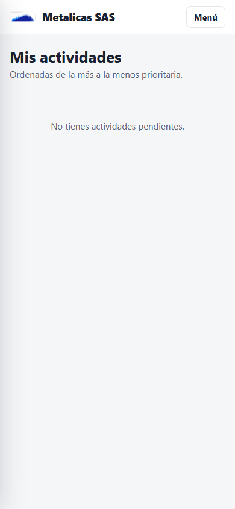<figcaption>Figura 1. Primera versión: lista y menú desplegable.</figcaption></figure>
<figure>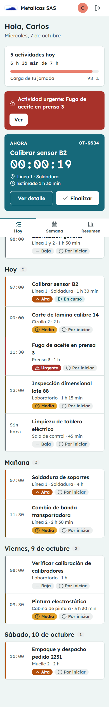<figcaption>Figura 2. Identidad visual: bloques apilados.</figcaption></figure>
<figure>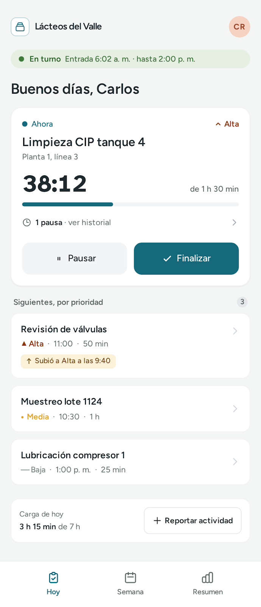<figcaption>Figura 3. Exploración con Stitch: el tanque de carga.</figcaption></figure>
<figure>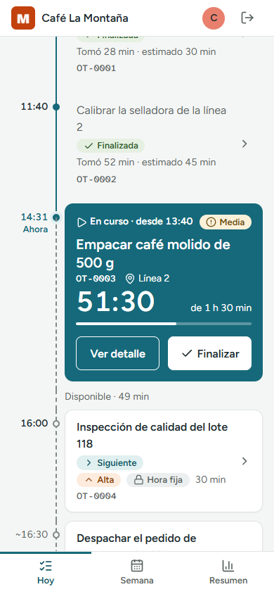<figcaption>Figura 4. Diseño actual: el día como línea de tiempo.</figcaption></figure>

**Cambios principales desde la primera fase:**

- La pantalla principal del Operario y la de ejecución se unieron en una sola, **Hoy**: la actividad en curso se ejecuta en su lugar del día.
- El fondo pasó de un tono aqua a un gris neutro, y la fuente de Lexend a Figtree, para leer más datos por renglón sin cansancio.
- Se quitaron las franjas de color al borde de las tarjetas: la prioridad se dice con una etiqueta.
- La jornada ahora tiene inicio y cierre: el Operario llega a un saludo con su turno y marca la entrada; al salir, ve el resumen de su día.

Antes de programar cada pantalla se dibujó su composición. La figura 5 es la maqueta de la pantalla Hoy.

<figure><figcaption>Figura 5. Maqueta de composición de la pantalla Hoy del Operario.</figcaption></figure>

## 4. Aplicación de principios de usabilidad

### 4.1 Visibilidad y claridad de las opciones disponibles

<figure><figcaption>Figura 6. Inicio de la jornada.</figcaption></figure>
<figure>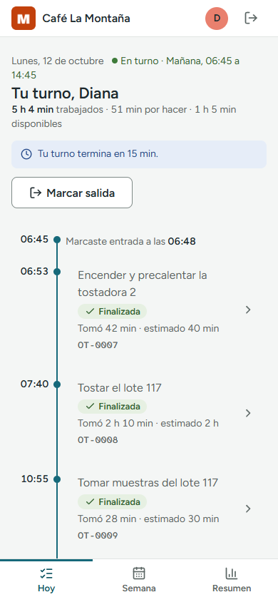<figcaption>Figura 7. El día, con "Marcar salida" siempre visible.</figcaption></figure>

- **Aplicación:** cada pantalla muestra solo las opciones del paso en que está la persona. Antes de entrar, la única acción es "Marcar entrada". Durante el día, las vistas están en una barra fija al alcance del pulgar, y "Marcar salida" está siempre arriba.
- **Problema que resuelve:** la marca de entrada y de salida quedaba al principio y al final de la línea de tiempo; en un día con varias actividades no se veía.
- **Justificación:** Ley de Hick: con menos opciones a la vista, la persona decide más rápido. Es clave para alguien que consulta el celular entre una tarea y otra.

### 4.2 Consistencia en componentes, estilos y comportamientos

<figure>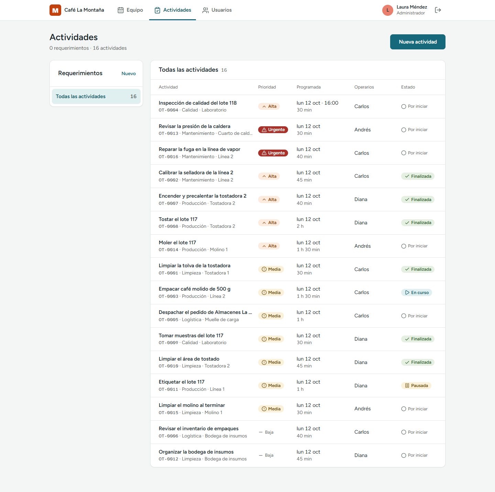<figcaption>Figura 8. Las mismas etiquetas de prioridad y estado que ve el Operario.</figcaption></figure>

- **Aplicación:** las etiquetas de prioridad y de estado son las mismas en las pantallas de los tres roles. Hay un solo botón principal por pantalla, siempre con el mismo relleno. Todos los formularios se abren en una ventana con "Cancelar" a la izquierda de la acción.
- **Problema que resuelve:** que la persona tenga que aprender de nuevo cada pantalla.
- **Justificación:** Ley de Jakob y heurística 4 de Nielsen. Los colores, la tipografía y los espacios están definidos una sola vez, como variables, en un único archivo de estilos.

### 4.3 Retroalimentación ante las acciones del usuario

<figure><figcaption>Figura 9. Confirmación "Salida registrada" y resumen del día.</figcaption></figure>
<figure><figcaption>Figura 10. El cronómetro muestra que la actividad está corriendo.</figcaption></figure>

- **Aplicación:** toda acción responde. Al guardar aparece un aviso breve; el botón se desactiva mientras se procesa; la actividad en curso muestra un cronómetro y una barra de avance; el encabezado dice "En turno" o "Fuera de turno".
- **Problema que resuelve:** la duda de si el sistema registró lo que se hizo, que lleva a tocar dos veces.
- **Justificación:** heurística 1 de Nielsen, visibilidad del estado del sistema.

### 4.4 Prevención y manejo de errores

<figure>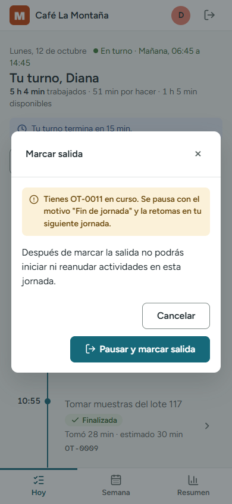<figcaption>Figura 11. Antes de salir, el sistema explica qué pasará.</figcaption></figure>
<figure>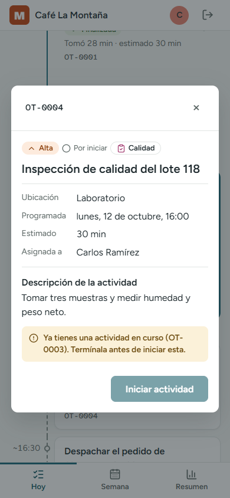<figcaption>Figura 12. Acción no disponible, con su motivo.</figcaption></figure>
<figure>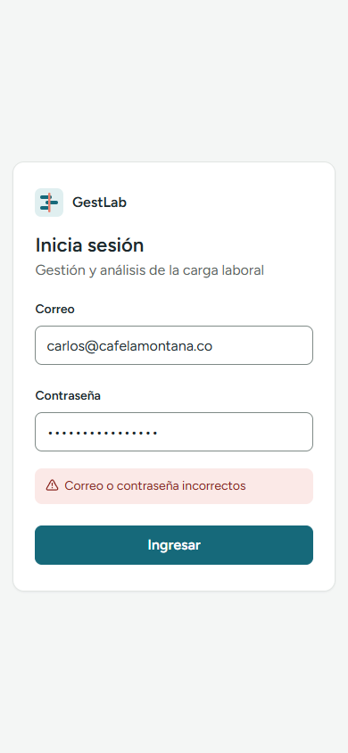<figcaption>Figura 13. Error dentro del formulario, en lenguaje claro.</figcaption></figure>

- **Aplicación (prevención):** cuando una acción no es posible, el botón se desactiva y un aviso dice por qué. Las acciones que no se pueden deshacer piden confirmación y explican la consecuencia. Si hay una actividad en curso al salir, el mismo diálogo la pausa.
- **Aplicación (manejo):** los errores aparecen dentro del formulario, con ícono y en palabras del usuario. Si se cae la conexión, el mensaje es "No hay conexión con el servidor. Revisa tu conexión e inténtalo de nuevo", no un código técnico.
- **Problema que resuelve:** salir con una actividad corriendo, que inflaba su tiempo real, y mensajes que el usuario no podía entender.
- **Justificación:** heurísticas 5 y 9 de Nielsen.

### 4.5 Facilidad de aprendizaje y comprensión

- **Aplicación:** la pantalla Hoy se lee como la planilla del turno que ya está pegada en la pared de la planta: las horas de arriba abajo y cada actividad en su hora (figura 4). Los íconos son de uso común y nunca van solos: siempre llevan su texto.
- **Problema que resuelve:** el tiempo de aprendizaje de una persona con poca familiaridad con aplicaciones.
- **Justificación:** heurística 2 de Nielsen: el sistema habla el lenguaje del usuario y usa objetos de su mundo. Ver la sección 7.

### 4.6 Claridad en la navegación y estructura

<figure><figcaption>Figura 14. Barra superior con las vistas del rol; la vista activa queda subrayada.</figcaption></figure>

- **Aplicación:** todas las pantallas comparten el mismo marco. En computador, las vistas del rol son pestañas en la barra superior; en celular pasan a una barra inferior. Cada rol ve solo sus vistas (tres como máximo), y la activa se marca con color y con una línea.
- **Problema que resuelve:** el menú desplegable de la primera versión escondía la navegación y obligaba a un toque de más.
- **Justificación:** Ley de Jakob: pestañas arriba y barra inferior son patrones que el usuario ya conoce de otras aplicaciones.

### 4.7 Jerarquía visual: acciones principales y secundarias

<figure><figcaption>Figura 15. Pantalla Hoy.</figcaption></figure>
<figure>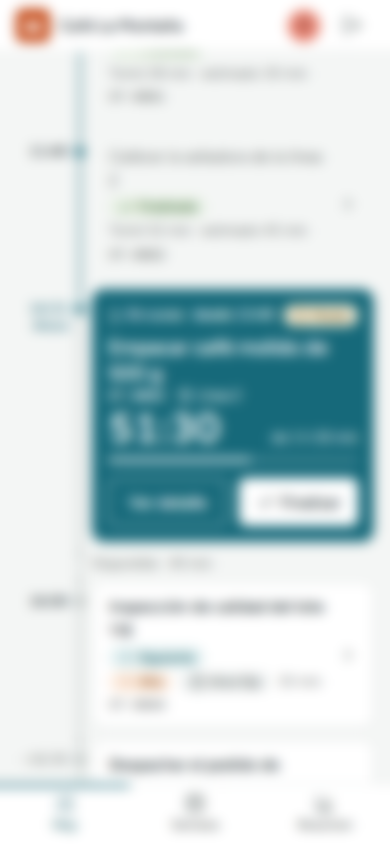<figcaption>Figura 16. La misma pantalla, desenfocada.</figcaption></figure>
<figure>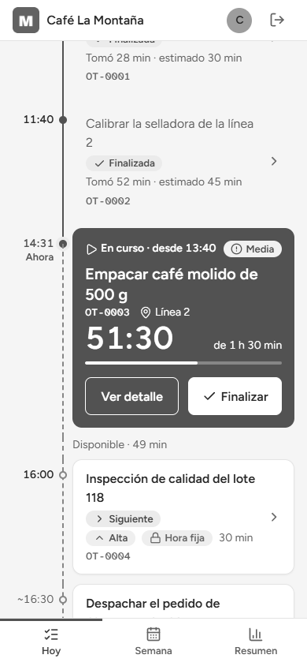<figcaption>Figura 17. La misma pantalla, en grises.</figcaption></figure>

- **Aplicación:** lo más importante de la pantalla es el bloque más grande y de color lleno: la actividad en curso. Dentro de él, "Finalizar" es el botón blanco lleno y "Ver detalle" solo tiene borde. Lo terminado se ve atenuado y lo que falta, en tarjetas blancas.
- **Cómo se comprobó:** con dos pruebas sobre la captura. Desenfocada (figura 16), lo único que sigue destacando es la actividad en curso. En grises (figura 17), la jerarquía se mantiene, así que no depende del color.
- **Problema que resuelve:** en la versión anterior competían cuatro bloques de color en la misma pantalla.

## 5. Aplicación de leyes de Gestalt

### 5.1 Proximidad

<figure><figcaption>Figura 18. Cada grupo de datos es un panel separado de los demás.</figcaption></figure>

- **Cómo se aplica:** los datos de una persona (nombre, correo y turno) van juntos y separados de la siguiente fila. Los dos límites de usuarios forman un grupo bajo un mismo título. En la barra superior, el avatar, el nombre, el rol y el botón de salir forman un bloque.
- **Justificación:** resuelve la duda de qué dato pertenece a quién sin dibujar líneas de más. Todos los espacios salen de una sola escala de siete pasos (4 a 48 px).

### 5.2 Semejanza

- **Cómo se aplica:** todo lo que cumple la misma función se ve igual. Las etiquetas de prioridad y de estado son píldoras con ícono y texto (figura 8); los botones principales comparten relleno; los enlaces de acción ("Cambiar turno", "Corregir") comparten color y no tienen borde (figura 18).
- **Justificación:** el usuario aprende un elemento una vez y lo reconoce en el resto del sistema.

### 5.3 Continuidad

<figure><figcaption>Figura 19. Operario: las horas de arriba abajo.</figcaption></figure>
<figure><figcaption>Figura 20. Administrador: una columna por persona y la línea de la hora actual.</figcaption></figure>

- **Cómo se aplica:** la línea de tiempo del Operario guía la mirada de arriba abajo siguiendo el paso de las horas. En Equipo, la línea de la hora actual cruza a todas las personas y permite comparar de un vistazo en qué va cada una.
- **Justificación:** el ojo sigue una línea sin esfuerzo; el orden de lectura coincide con el orden del día.

### 5.4 Cierre

- **Cómo se aplica:** en la figura 19, la línea es continua hasta "Ahora" y punteada después. Aunque esté interrumpida, se percibe como una sola línea: la persona completa la forma.
- **Justificación:** el trazo punteado comunica "esto todavía no ha pasado" sin escribirlo, y mantiene unido el día.

### 5.5 Figura y fondo

- **Cómo se aplica:** los paneles blancos se separan del fondo gris neutro por contraste, un borde tenue y una sombra muy suave. Al abrir un diálogo, el resto de la pantalla se oscurece (figuras 11 y 12).
- **Justificación:** solo queda en primer plano lo que se está atendiendo. El fondo gris, en lugar de blanco, reduce el cansancio visual en una herramienta que se usa toda la jornada.

## 6. Teoría del color

El sistema de color se llama **Calma operativa**. Cada color tiene un único significado, y es el mismo en todas las pantallas de los tres roles.

### 6.1 Paleta principal

| Función | HEX | Dónde se usa | Contraste |
|---|---|---|---|
| Fondo | `#F4F6F5` | Fondo general de todas las pantallas | — |
| Superficie | `#FFFFFF` | Tarjetas, tablas y diálogos | — |
| Principal | `#16697A` | Botón de acción principal, vista activa, actividad en curso, línea "Ahora" | Texto blanco encima: 6,3:1 |
| Principal al presionar | `#0F5563` | Botón principal presionado | 7,1:1 |
| Principal suave | `#E0EFF0` | Etiqueta "En curso", elemento seleccionado | — |
| Acento de marca (coral) | `#E9806E` | Logo, avatar y sobrecarga. Nunca en texto | No se usa en texto |
| Texto principal | `#1F2A2E` | Títulos y texto | 14,7:1 sobre blanco |
| Texto secundario | `#5B6664` | Datos de apoyo | 5,95:1 sobre blanco |

**Color de las acciones principales:** el principal `#16697A`. Es el único relleno de botón de toda la interfaz, y hay uno solo por pantalla.

### 6.2 Paleta secundaria: estados, alertas, errores, confirmaciones e información

Cada estado tiene tres variantes: base para rellenos, fondo suave para etiquetas y texto oscuro para escribir encima.

| Significado | Base | Fondo suave | Texto | Contraste texto/fondo |
|---|---|---|---|---|
| Error, prioridad Urgente | `#A8322A` | `#FBE9E7` | `#8A2620` | 7,5:1 |
| Prioridad Alta | `#B34F0B` | `#FDEBDD` | `#8A3D08` | 6,6:1 |
| Advertencia, prioridad Media, pausada | `#E3A32B` | `#FBF1D9` | `#6B4A0E` | 7,2:1 |
| Confirmación, finalizada, en turno | `#3E7B3A` | `#E6F0E2` | `#2F5F2C` | 6,4:1 |
| Información | `#2F5DA8` | `#E6EDF8` | `#24498A` | 7,5:1 |
| Normal: prioridad Baja, por iniciar | `#6B7478` | `#ECEFEF` | `#5B6664` | 5,15:1 |

### 6.3 Contraste

- Todo texto cumple al menos 4,5:1 contra su fondo y todo componente al menos 3:1 (WCAG 2.1, nivel AA). Los textos principales superan 7:1 (nivel AAA).
- Los contrastes no se estimaron: se midieron con una herramienta propia (`herramientas/contraste.py`) sobre los valores reales del archivo de estilos.
- La medición descartó dos colores: el ámbar base sobre blanco (2,2:1) y un gris claro para texto (3,09:1). Para escribir sobre ámbar se usa su texto oscuro.

### 6.4 Justificación de la selección

- **Contexto de uso.** La herramienta se usa durante toda la jornada. Por eso el fondo es un gris neutro y no blanco, el texto no es negro puro y el color intenso aparece solo cuando hay algo que atender.
- **Lo que el operario ya conoce.** Los colores de estado siguen la señalización de seguridad de la planta (norma ISO 3864): rojo para peligro, amarillo para precaución, verde para condición segura y azul para indicación. No hay que aprender un código nuevo.
- **Lo normal va en gris.** Una actividad por iniciar o de prioridad baja no lleva color. Así, cuando algo aparece en color es porque requiere atención.
- **Armonía complementaria.** El principal (tono 190°) y el coral de marca (tono 9°) están en lados opuestos de la rueda de color. El coral ocupa muy poca superficie: identifica la marca sin competir con los estados.
- **Proporción 60-30-10.** Cerca de 60 % de fondo y superficies, 30 % de texto y color principal, y 10 % de acento y estados.
- **Visión de personas mayores.** Se usan colores de saturación media, y el azul no se usa en texto pequeño.

### 6.5 Consistencia y evidencias

Tres reglas garantizan la consistencia:

1. Todo estado, prioridad o aviso se comunica con **color, ícono y texto**; nunca solo con color.
2. Cada color tiene **un solo significado** en todo el producto.
3. Todos los colores están definidos como variables en un único lugar del código.

<figure>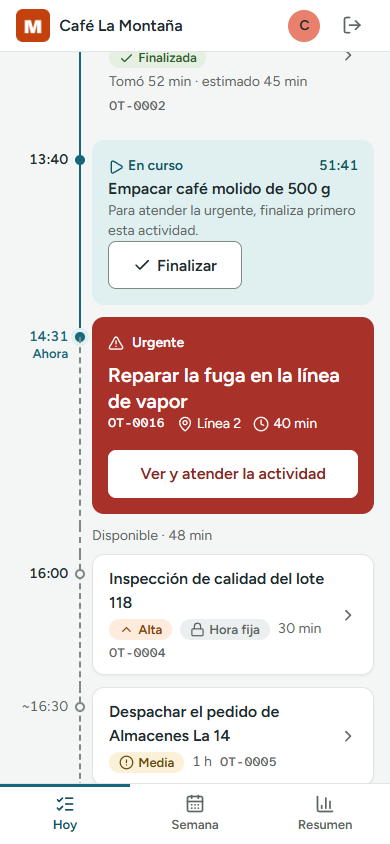<figcaption>Figura 21. El rojo lleno se reserva para lo urgente: es el único bloque rojo de la pantalla.</figcaption></figure>
<figure><figcaption>Figura 22. Azul suave para información que no pide una acción.</figcaption></figure>

<figure><figcaption>Figura 23. Los mismos colores en el Administrador: rojo urgente, naranja alta, ámbar media, verde finalizada.</figcaption></figure>

En la figura 14 se ve la misma regla en la asistencia: "Sin marca" en rojo suave, "Por validar" en ámbar y "Validada" en verde, cada una con su ícono y su texto.

## 7. Metáforas de la interfaz

Una metáfora de interfaz usa un objeto que la persona ya conoce para explicar una función del sistema.

### 7.1 Metáfora central: la planilla del turno

- **Significado:** es la planilla que se pega en la pared de la planta para saber quién hace qué y a qué hora.
- **Clasificación:** organizacional, porque ordena toda la información de la pantalla.
- **Cómo se ve:** el Administrador ve la planilla completa, con una columna por persona (figura 20). El Operario ve su propio renglón, en vertical (figura 19). Cada actividad es una tarjeta puesta en su hora, y la línea "Ahora" marca la hora actual.
- **Por qué esta:** reemplazó a la metáfora del tanque de carga (figura 3). El tanque decía cuánto trabajo había, pero no cuándo; la planilla responde las dos preguntas.

### 7.2 Metáforas de apoyo

| Objeto del mundo real | Qué significa en GestLab | Clasificación | Dónde se ve |
|---|---|---|---|
| Candado | Actividad de hora fija: no se puede mover | Visual | Figura 4, tarjeta "Inspección de calidad" |
| Botones de un reproductor | Iniciar (reproducir) y finalizar (visto bueno) una actividad | Funcional | Figura 10, actividad en curso |
| Cronómetro | Tiempo que lleva la actividad en curso | Visual | Figura 10 |
| Marcador de mapa | Lugar donde se hace el trabajo | Visual | Figuras 10 y 21 |
| Franjas diagonales de zona restringida | El tiempo que queda fuera del turno | Visual | Figura 19, "Fin del turno" |
| Puerta de salida | Cerrar sesión y marcar la salida | Visual | Barra superior y figura 7 |
| Señal de advertencia (triángulo) | Actividad urgente | Visual | Figura 21 |
| Reorganizar tarjetas sobre una mesa | Ordenar mi día | Funcional | Figura 24 |

<figure>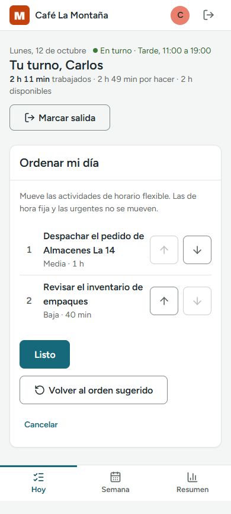<figcaption>Figura 24. Ordenar mi día: las actividades de horario flexible se suben y se bajan.</figcaption></figure>

### 7.3 Buenas prácticas aplicadas

- **Metáforas del contexto del usuario:** la planilla y las franjas de seguridad son objetos de la planta.
- **Íconos con texto:** ningún ícono va solo.
- **Claridad antes que realismo:** todo se dibuja plano, sin imitar texturas.
- **Límite de la metáfora:** la planilla dice cuándo se hace cada cosa, pero no cuánto pesa el día. Por eso el encabezado suma las horas en texto ("2 h 11 min trabajados · 2 h 49 min por hacer").

## 8. Componentes y patrones visuales

| Componente | Patrón | Evidencia |
|---|---|---|
| Marco de la aplicación | Barra superior con pestañas; barra inferior en celular | Figuras 7 y 14 |
| Tarjeta de actividad | Título, etiquetas y datos; se toca para ver el detalle | Figura 4 |
| Etiqueta | Píldora con color, ícono y texto | Figura 8 |
| Diálogo | Ventana sobre la pantalla, con "Cancelar" y una acción principal | Figura 11 |
| Aviso | Fondo suave con ícono y una frase | Figuras 12 y 22 |
| Confirmación breve | Mensaje flotante que desaparece solo | Figura 9 |
| Medidor | Barra de avance con su cifra | Figura 14, "Límites de usuarios" |

<figure>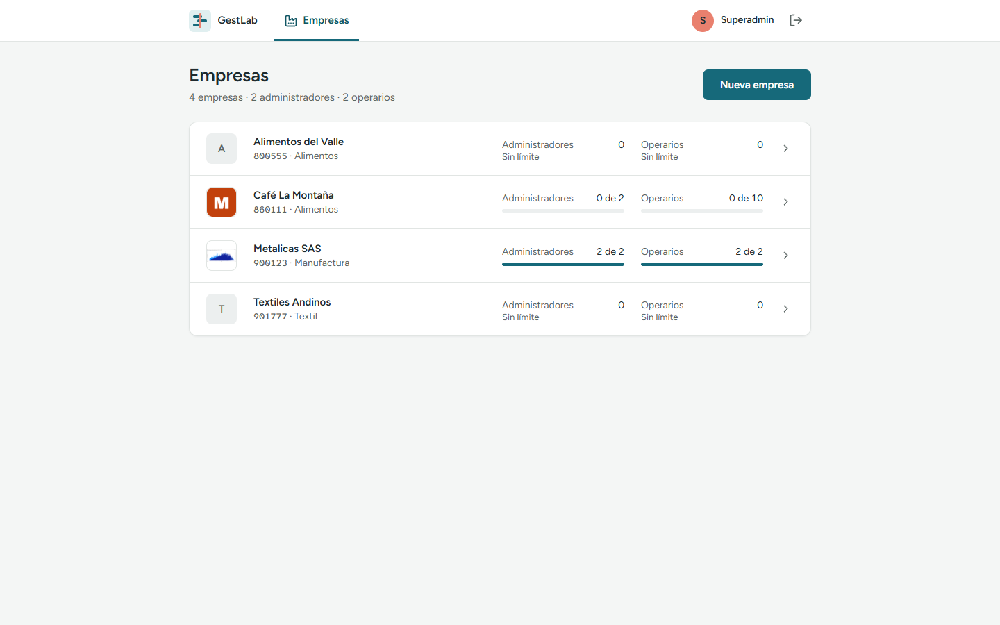<figcaption>Figura 25. Superadmin: lista de empresas.</figcaption></figure>
<figure>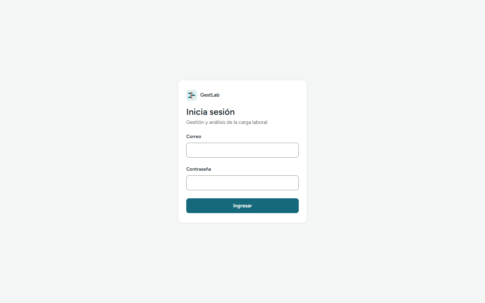<figcaption>Figura 26. Inicio de sesión.</figcaption></figure>

## 9. Conclusiones

**Principales aprendizajes**

- Una metáfora bien elegida ordena la interfaz completa. Pasar del tanque a la planilla del turno resolvió de una vez la jerarquía, la continuidad y la facilidad de aprendizaje.
- El color comunica más cuando se usa menos. Dejar lo normal en gris hizo que lo urgente se notara sin necesidad de agrandarlo.
- Medir es mejor que opinar. La prueba de contraste descartó dos colores que a simple vista parecían correctos, y la prueba de desenfoque mostró qué dominaba de verdad cada pantalla.

**Dificultades encontradas**

- Mostrar un día cargado en un celular sin que la actividad en curso quedara fuera de la vista. Se resolvió abriendo la pantalla en la hora actual.
- Colores cálidos cercanos entre sí: el coral de marca, el rojo de urgente y el naranja de alta. Se separaron por luminosidad, por uso y con el texto de cada etiqueta.
- La propuesta generada con una herramienta automática fue atractiva pero no respondía a la pregunta del usuario. Hubo que revisarla con criterio antes de adoptarla.

**Decisiones de diseño más relevantes**

1. El día del Operario como línea de tiempo, con la actividad en curso abierta en su hora.
2. Color, ícono y texto en todo estado, sin excepción.
3. Un solo botón principal por pantalla.
4. La jornada con inicio y cierre: saludo y entrada al llegar, resumen al salir.

**Aspectos por mejorar en la siguiente iteración**

- Las pantallas del Administrador todavía usan el modelo anterior en dos puntos: la lista lateral de "Requerimientos" y el horario por columnas. Falta llevarlas al tablero del turno y a la vista de proyectos.
- En la pantalla Hoy falta el botón para pausar una actividad con su motivo; hoy solo se pausa al marcar la salida.
- No hay una ayuda dentro de la aplicación para quien la usa por primera vez.
- Algunos datos de apoyo dependen de un texto emergente que no existe en pantallas táctiles.
