# GestLab — Avance del proyecto

**Diseño Orientado a Objetos · Momento Evaluativo 2**

| | |
|---|---|
| Proyecto | GestLab: sistema web para la gestión y el análisis de la carga laboral de operarios |
| Integrantes | Pedro David González Lesmes y Sebastián Vargas |
| Fecha | Octubre de 2026 |
| Repositorio | https://github.com/PedroGonzalez9612/TaskManager |

GestLab responde tres preguntas de una empresa con operarios: qué se debe hacer, quién lo está haciendo y cuánto trabajo hay en curso. Tiene tres roles: el Superadmin registra empresas, el Administrador crea y asigna actividades, y el Operario las ejecuta.

Este documento sigue los cinco puntos del enunciado, en el mismo orden.

---

## 1. Modelado de la base de datos

El motor es **MongoDB 7**, una base de datos de documentos. Por eso el modelo lógico se expresa en colecciones y documentos, y no en tablas.

### 1.1 Modelo lógico

Tres decisiones definen el modelo:

- **Todo pertenece a una empresa.** Casi todas las colecciones llevan `empresa_id`, y cada consulta filtra por él: una empresa nunca ve datos de otra.
- **La ejecución pertenece a la asignación.** Una actividad puede tener varios operarios. Cada uno tiene su propia ejecución, con su tiempo, sus pausas y su observación. La actividad termina cuando todos finalizan.
- **Nada se borra.** Una asignación se cierra (devuelta o retirada) y una actividad se cancela con motivo. El historial queda en la base.

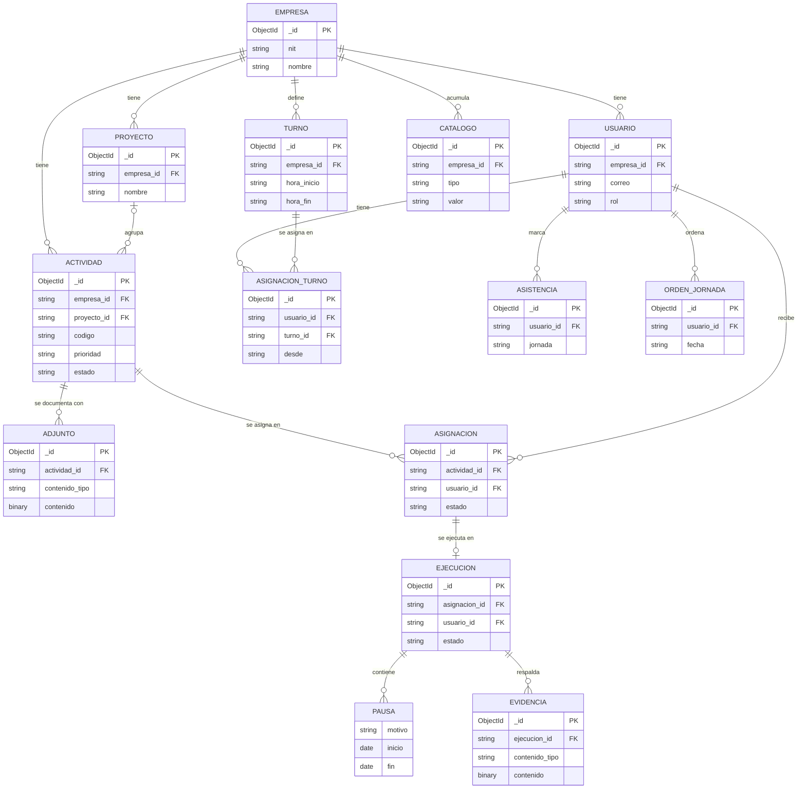

**Cómo leer las relaciones**

| Relación | Regla |
|---|---|
| Empresa – Usuario | Una empresa tiene varios usuarios. El Superadmin no pertenece a ninguna |
| Proyecto – Actividad | Una actividad es independiente o pertenece a un solo proyecto |
| Actividad – Asignación – Usuario | Relación de muchos a muchos: una actividad se asigna a uno o varios operarios |
| Asignación – Ejecución | Cada asignación tiene como máximo una ejecución, que nace cuando el operario inicia |
| Ejecución – Pausa | Las pausas viven dentro de la ejecución; no existen por separado |
| Ejecución – Evidencia | Cada ejecución tiene hasta 5 archivos de evidencia (fotos o PDF). Van en su propia colección porque pesan mucho más que el resto de la ejecución |
| Actividad – Información | La información para hacer el trabajo (pasos, herramientas y materiales, equipo, precauciones de seguridad y contacto) vive dentro de la actividad |
| Actividad – Adjunto | Cada actividad tiene hasta 5 archivos de referencia (manuales, planos o fotos) que sube el Administrador. Van en su propia colección, como la evidencia |
| Usuario – Turno | Un operario tiene un solo turno vigente; se guarda la fecha de cada cambio |
| Usuario – Asistencia | Una asistencia por operario y jornada |

**Referenciar o incrustar.** En una base de documentos, cada relación se resuelve de una de dos formas:

- **Referencia** (se guarda el identificador del otro documento): cuando el otro dato tiene vida propia y se consulta por separado. Así se relacionan empresas, usuarios, actividades, asignaciones y ejecuciones.
- **Documento incrustado** (el dato va dentro del documento principal): cuando el dato no tiene sentido sin su dueño y siempre se lee con él. Así se guardan las pausas de una ejecución, la información, las reprogramaciones y la cancelación de una actividad, la devolución de una asignación y la revisión de una asistencia.

### 1.2 Modelo físico

La base se llama `taskmanager` y tiene 14 colecciones. Los índices los crea la aplicación al arrancar, desde cada repositorio (`app/repositories/`).

**Convenciones de tipos**

- Los identificadores propios son `ObjectId`. Las referencias a otros documentos se guardan como texto (`string`) con ese mismo identificador.
- Los momentos (inicio, fin, marca de entrada) son `date` en UTC, y los pone el servidor.
- Los días (`fecha_programada`, `jornada`) son texto `AAAA-MM-DD`, y las horas del día son texto `HH:MM`: un día de trabajo no es un instante, depende de la zona horaria de la empresa.
- Los estados, roles y prioridades son texto con los valores de las enumeraciones de `app/models/enums.py`.

#### `empresas`

| Campo | Tipo | Descripción |
|---|---|---|
| `_id` | ObjectId | Identificador |
| `nombre`, `nit`, `sector`, `direccion` | string | Datos de la empresa |
| `limite_administradores`, `limite_operarios` | number | Cuántos usuarios de cada rol puede tener |
| `zona_horaria` | string | Define qué día es "hoy" para la empresa |
| `logo` | binario | Imagen del logo (marca blanca) |
| `logo_tipo` | string | Tipo de la imagen (PNG, JPG o WEBP) |
| `consecutivo_actividad` | number | Último número usado en el código de las actividades |
| `activa` | boolean | `false` si el Superadmin la desactivó: sus usuarios no pueden iniciar sesión. Las empresas no se borran |

#### `usuarios`

| Campo | Tipo | Descripción |
|---|---|---|
| `_id` | ObjectId | Identificador |
| `nombre`, `correo` | string | Datos del usuario |
| `contraseña_hash` | string | Contraseña cifrada con bcrypt; nunca sale en la API |
| `rol` | string | `SUPERADMIN`, `ADMINISTRADOR` u `OPERARIO` |
| `empresa_id` | string o null | Empresa a la que pertenece; `null` en el Superadmin |
| `activo` | boolean | `false` si se desactivó: no inicia sesión ni recibe actividades. Los usuarios no se borran |

#### `proyectos`

| Campo | Tipo | Descripción |
|---|---|---|
| `_id` | ObjectId | Identificador |
| `nombre`, `descripcion` | string | Datos del proyecto |
| `empresa_id` | string | Empresa dueña |
| `creado_por_id` | string | Administrador que lo creó |
| `fecha_creacion` | date | Momento de creación |

Índice: `empresa` (`empresa_id`).

#### `actividades`

| Campo | Tipo | Descripción |
|---|---|---|
| `_id` | ObjectId | Identificador |
| `codigo` | string | Código visible, por ejemplo `OT-0001` |
| `titulo`, `descripcion`, `ubicacion` | string | Datos de la actividad |
| `empresa_id` | string | Empresa dueña |
| `proyecto_id` | string o null | Proyecto al que pertenece; `null` si es independiente |
| `categoria` | string | `OPERACION`, `ATENCION`, `ADMINISTRATIVA`, `REVISION` o `TRASLADO`: tipos de trabajo que sirven para cualquier empresa |
| `prioridad` | string | `BAJA`, `MEDIA`, `ALTA` o `URGENTE` |
| `tiempo_estimado_min` | number | Tiempo estimado de la actividad completa, en minutos |
| `fecha_programada` | string | Día en que debe hacerse |
| `hora_programada` | string o null | Hora fija; `null` si es de horario flexible |
| `fecha_original` | string | Primer día programado, para medir los días de retraso |
| `estado` | string | Estado calculado a partir de las ejecuciones de sus operarios |
| `informacion` | documento | Los bloques de información que eligió el Administrador (`bloques`) y el contenido de cada uno: `pasos`, `herramientas`, `equipo`, `precauciones` y `contacto` |
| `reprogramaciones` | lista de documentos | Cada paso automático a otra jornada: origen, destino y fecha |
| `cancelacion` | documento o null | Motivo, autor y fecha, si fue cancelada |
| `fecha_no_realizada` | date o null | Cuándo quedó como No realizada |
| `requerimiento_id` | string o null | Campo heredado; se retira con los requerimientos |

Índices: `empresa_fecha` (`empresa_id`, `fecha_programada`) y `empresa_proyecto` (`empresa_id`, `proyecto_id`).

#### `asignaciones`

| Campo | Tipo | Descripción |
|---|---|---|
| `_id` | ObjectId | Identificador |
| `actividad_id`, `usuario_id` | string | Qué actividad y qué operario |
| `estado` | string | `ACTIVA`, `DEVUELTA` o `RETIRADA` |
| `asignada_por_id` | string | Administrador que asignó |
| `fecha_asignacion` | date | Cuándo se asignó |
| `fecha_fin` | date o null | Cuándo se cerró |
| `retirada_por_id` | string o null | Administrador que la retiró |
| `devolucion` | documento o null | Motivo y fecha, si el operario la devolvió |

Índices: `asignacion_activa_unica` (`actividad_id`, `usuario_id`), **único y parcial** sobre las activas; y `usuario_estado` (`usuario_id`, `estado`).

#### `ejecuciones`

| Campo | Tipo | Descripción |
|---|---|---|
| `_id` | ObjectId | Identificador |
| `asignacion_id` | string | Asignación a la que pertenece |
| `actividad_id`, `usuario_id` | string | Copias para consultar sin pasar por la asignación |
| `estado` | string | `EN_PROGRESO`, `PAUSADA`, `FINALIZADA` o `CERRADA` |
| `fecha_inicio`, `fecha_fin` | date | Inicio y fin reales |
| `pausas` | lista de documentos | Cada pausa con su motivo, inicio y fin |
| `observacion` | string o null | Nota del operario al finalizar |

Índices: `asignacion_unica` (`asignacion_id`), **único**; `una_en_progreso_por_usuario` (`usuario_id`), **único y parcial** sobre las que están en progreso; y `actividad` (`actividad_id`).

#### `turnos` y `asignaciones_turno`

| Colección | Campo | Tipo | Descripción |
|---|---|---|---|
| `turnos` | `nombre` | string | Nombre del turno |
| | `hora_inicio`, `hora_fin` | string | Horario del turno |
| | `descanso_min` | number | Minutos de descanso; se restan de la capacidad |
| | `empresa_id` | string | Empresa dueña |
| `asignaciones_turno` | `usuario_id`, `turno_id` | string | Qué operario y qué turno |
| | `desde` | string | Día desde el que rige |
| | `asignado_por_id` | string | Administrador que lo asignó |
| | `fecha_registro` | date | Cuándo se registró el cambio |

Índices: `empresa_hora_inicio` (`empresa_id`, `hora_inicio`) en `turnos`; `usuario_desde` (`usuario_id`, `desde`) en `asignaciones_turno`.

#### `asistencias`

| Campo | Tipo | Descripción |
|---|---|---|
| `_id` | ObjectId | Identificador |
| `usuario_id`, `empresa_id` | string | Operario y empresa |
| `jornada` | string | Día en que inicia el turno |
| `entrada`, `salida` | date | Marcas del operario; `salida` es `null` mientras no marque |
| `estado` | string | Por validar, validada o corregida |
| `revision` | documento o null | Quién validó o corrigió, cuándo, el motivo y las marcas originales |

Índices: `una_por_jornada` (`usuario_id`, `jornada`), **único**; y `empresa_jornada` (`empresa_id`, `jornada`).

#### `ordenes_jornada`

| Campo | Tipo | Descripción |
|---|---|---|
| `usuario_id` | string | Operario |
| `fecha` | string | Jornada |
| `actividad_ids` | lista de string | Orden que el operario eligió para sus actividades de horario flexible |
| `fecha_actualizacion` | date | Último cambio |

Índice: `orden_unico_por_dia` (`usuario_id`, `fecha`), **único**.

#### `evidencias`

Fotos y adjuntos que el operario deja al finalizar una actividad. El archivo se guarda dentro del documento, como el logo de la empresa: con el límite de 5 MB por archivo cabe sin pasar del máximo de MongoDB (16 MB por documento).

| Campo | Tipo | Descripción |
|---|---|---|
| `_id` | ObjectId | Identificador |
| `ejecucion_id`, `actividad_id`, `usuario_id`, `empresa_id` | string | A qué ejecución pertenece, y copias para comprobar quién la puede ver |
| `nombre` | string | Nombre del archivo, sin la carpeta de quien lo subió |
| `contenido_tipo` | string | `image/jpeg`, `image/png`, `image/webp` o `application/pdf`, reconocido por los primeros bytes del archivo y no por su nombre |
| `tamano` | number | Bytes del archivo |
| `fecha` | date | Cuándo se subió |
| `contenido` | binario | El archivo. Las consultas de listado no lo traen |

Índice: `ejecucion` (`ejecucion_id`).

#### `adjuntos`

Archivos de referencia que el Administrador deja en una actividad, como parte de su información (manuales, planos o fotos). Se guardan igual que la evidencia, pero pertenecen a la actividad y no a una ejecución.

| Campo | Tipo | Descripción |
|---|---|---|
| `_id` | ObjectId | Identificador |
| `actividad_id`, `empresa_id` | string | A qué actividad pertenece y su empresa |
| `autor_id` | string | Administrador que lo subió |
| `nombre`, `contenido_tipo`, `tamano` | string y number | Datos del archivo, con el tipo reconocido por su contenido |
| `fecha` | date | Cuándo se subió |
| `contenido` | binario | El archivo. Las consultas de listado no lo traen |

Índice: `actividad` (`actividad_id`).

#### `catalogos`

Listas por empresa que se llenan con lo que escriben los usuarios: los motivos de pausa y de cancelación (con la opción "Otro") y las sugerencias de la información de las actividades (herramientas, equipo, precauciones y contactos que la empresa ya usó).

| Campo | Tipo | Descripción |
|---|---|---|
| `empresa_id` | string | Empresa dueña |
| `tipo` | string | `MOTIVO_PAUSA`, `MOTIVO_CANCELACION`, `HERRAMIENTA`, `EQUIPO`, `PRECAUCION` o `CONTACTO` |
| `valor` | string | Texto tal como se muestra |
| `clave` | string | El mismo texto normalizado, para no repetir valores |

Índice: `valor_unico` (`empresa_id`, `tipo`, `clave`), **único**.

#### `requerimientos`

Colección de la primera versión (`titulo`, `descripcion`, `empresa_id`, `estado`, `fecha_creacion`). El modelo actual la reemplaza por proyectos y actividades independientes; se retira cuando la pantalla nueva del Administrador esté lista.

### 1.3 Reglas que garantiza la base de datos

Algunas reglas no pueden depender solo del código, porque dos peticiones pueden llegar al mismo tiempo. Para esas, la base rechaza el segundo intento con un índice único:

| Regla de negocio | Índice |
|---|---|
| Un operario tiene una sola actividad en ejecución a la vez | `una_en_progreso_por_usuario` |
| Una asignación tiene una sola ejecución | `asignacion_unica` |
| Un operario no queda asignado dos veces a la misma actividad | `asignacion_activa_unica` |
| Una sola asistencia por operario y jornada | `una_por_jornada` |
| Un solo orden del día por operario y jornada | `orden_unico_por_dia` |
| Un motivo no se repite en el catálogo de una empresa | `valor_unico` |

Los índices **parciales** aplican solo a los documentos que cumplen una condición. Por ejemplo, `una_en_progreso_por_usuario` solo mira las ejecuciones en progreso: un operario puede tener muchas ejecuciones finalizadas, pero solo una en curso.

### 1.4 Cómo comprobarlo en el motor

Con la aplicación levantada en Docker:

```bash
docker compose exec mongo mongosh taskmanager
```

```javascript
show collections                    // las colecciones
db.ejecuciones.getIndexes()         // los índices de una colección
db.actividades.findOne()            // un documento de ejemplo
```

---

## 2. Inicio de la implementación

### 2.1 Tecnología web

| Parte | Tecnología |
|---|---|
| Servidor | Python 3.11 con Flask: expone una API REST en JSON |
| Cliente | HTML, CSS y JavaScript en el navegador; consume la API con `fetch` |
| Base de datos | MongoDB 7, con la biblioteca `pymongo` |
| Seguridad | Sesión de Flask con cookie; contraseñas con bcrypt |
| Entorno | Docker Compose: un contenedor para la aplicación y otro para la base |
| Calidad | Pruebas automáticas con pytest y análisis con SonarQube |

### 2.2 Arquitectura en capas

Cada capa solo conoce a la que tiene debajo:

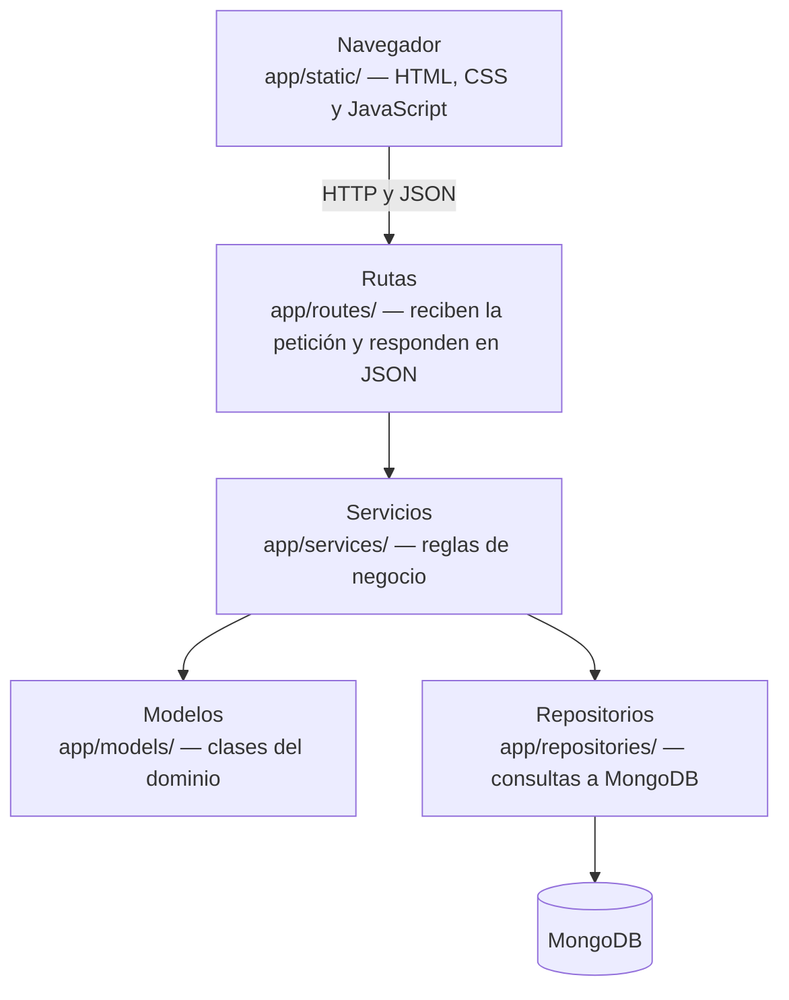

| Capa | Responsabilidad | Lo que no hace |
|---|---|---|
| Modelos | Clases del dominio (`Actividad`, `Asignacion`, `Ejecucion`, `Pausa`). Validan sus propios cambios de estado | No acceden a la base ni a Flask |
| Repositorios | Único lugar con consultas a MongoDB (patrón Repository) | No tienen reglas de negocio |
| Servicios | Reglas de negocio. Reciben los repositorios por el constructor | No conocen HTTP ni escriben consultas |
| Rutas | Reciben la petición, llaman al servicio y devuelven JSON | No tienen reglas ni consultas |

### 2.3 Conexión con la base de datos

La conexión se abre una sola vez, al arrancar la aplicación, en `app/extensions.py`:

```python
def init_db(app):
    global _client, _db
    _client = MongoClient(app.config["MONGO_URI"])
    _db = _client[app.config["MONGO_DB_NAME"]]
    return _db
```

- La dirección de la base (`MONGO_URI`) y su nombre (`MONGO_DB_NAME`) se leen de variables de entorno, en `app/config.py`. No están escritas en el código.
- Toda la aplicación comparte ese único cliente. `pymongo` administra por dentro un grupo de conexiones y las reutiliza entre peticiones.
- La base se entrega a cada repositorio por su constructor, y los repositorios a los servicios. Ningún servicio abre conexiones por su cuenta.
- En Docker, la aplicación llega a la base por el nombre del contenedor: `mongodb://mongo:27017`.
- `GET /health` responde si el servidor está arriba.

**Cómo se comprueba que funciona.** El proyecto tiene 526 pruebas automáticas (`python -m pytest`) que ejercitan los modelos, los servicios y las rutas sobre una base en memoria, con los mismos índices de la base real.

### 2.4 Qué funciona hoy

| Rol | Puede |
|---|---|
| Todos | Iniciar y cerrar sesión; cada rol llega a su propia pantalla |
| Superadmin | Registrar empresas con sus límites de usuarios y su logo, crear sus Administradores y desactivar o reactivar una empresa |
| Administrador | Crear, desactivar y reactivar usuarios; crear actividades con su información para hacer el trabajo (pasos, herramientas, precauciones, contacto y archivos adjuntos) y asignarlas a uno o varios operarios; cancelar con motivo; ver el registro y la evidencia de cada operario; ver la carga del equipo en el tablero del turno; crear turnos y validar o corregir la asistencia |
| Operario | Llegar a su página de Inicio y marcar la entrada (con alerta si llega tarde); ver su día como una línea de tiempo, o solo consultarlo sin haber marcado la entrada; iniciar, pausar con motivo, atender una urgente, reanudar y finalizar actividades, con evidencia (observación, fotos y adjuntos); ordenar sus actividades de horario flexible viendo a qué hora queda cada una; ver cuánto tiempo implica lo que pasa de su turno; marcar la salida |

---

### 2.5 Las reglas viven en las clases

Las reglas de negocio no dependen de que la pantalla esconda un botón: cada clase protege sus propios cambios de estado. Si se pide algo que el estado no permite, el método lanza un error antes de cambiar nada (una **precondición**), y la base de datos nunca queda en un estado inválido.

| Clase | Método | Regla que protege |
|---|---|---|
| `Actividad` | `cancelar()` | No se cancela lo que ya terminó ni lo que alguien tiene en curso |
| `Ejecucion` | `pausar()`, `reanudar()`, `finalizar()` | Solo se pausa lo que está en curso, solo se reanuda lo pausado y solo se finaliza lo que está en curso |
| `Asistencia` | `corregir()` | Una corrección exige motivo y conserva las marcas originales |
| `Usuario` | `desactivar()`, `reactivar()` | No se desactiva dos veces ni se reactiva a quien ya está activo |
| `Evidencia` | `desde_archivo()` | Solo fotos o PDF, de 5 MB como máximo, reconocidos por su contenido |

Las reglas que dependen de otros datos (por ejemplo, "una actividad que alguien ya inició no se edita" o "un operario con actividades sin terminar no se desactiva") las aplica el servicio, que consulta los repositorios. En el alcance hay una tabla con lo que se permite en cada estado de la actividad, y cada regla tiene su prueba automática.

### 2.6 Diagrama de clases

El diagrama de clases muestra las clases que hay en el código, con sus atributos, sus métodos y cómo se relacionan. Sale directamente de `app/models/` (las clases del dominio), `app/repositories/` y `app/services/`: lo que aparece aquí existe en el repositorio.

Para que se pueda leer, está dividido en cuatro partes: dos del dominio, las enumeraciones y las capas.

**Cómo leer los diagramas**

| Símbolo | Relación | Significado en GestLab |
|---|---|---|
| Flecha con triángulo hueco | Herencia | La clase hija es un caso particular de la madre y hereda lo que esta define |
| Rombo relleno | Composición | La parte no existe sin el todo y se guarda dentro de él (por ejemplo, las pausas viven dentro de su ejecución) |
| Rombo hueco | Agregación | El todo agrupa partes que existen por sí mismas (un proyecto agrupa actividades independientes) |
| Flecha simple | Asociación | Una clase conoce a la otra por su identificador |
| Flecha punteada | Dependencia | La clase usa a la otra, por ejemplo un tipo enumerado o un servicio que recibe por el constructor |
| `1`, `0..1`, `0..*` | Multiplicidad | Cuántos objetos de cada lado participan |
| `+` | Visibilidad pública | Atributo o método que otras clases pueden usar |
| Subrayado o `$` | Método de clase | Se llama sobre la clase, no sobre un objeto (por ejemplo, `desde_documento`) |

#### 2.6.1 Dominio: personas, empresas, turnos y asistencia

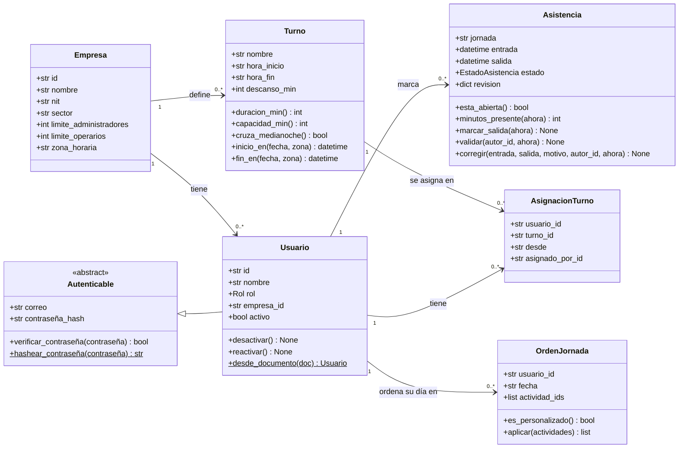

- **Herencia y abstracción.** `Autenticable` es una clase abstracta: reúne lo que necesita cualquier cosa que inicia sesión (el correo, la contraseña cifrada con bcrypt y cómo verificarla). `Usuario` hereda de ella y agrega lo propio: el nombre, el rol y la empresa.
- **Encapsulamiento.** Para dar de baja a un usuario no se cambia el atributo `activo` desde afuera: se llama a `desactivar()`, que primero comprueba que no esté ya desactivado.
- **Un turno a la vez, con historia.** `AsignacionTurno` registra desde qué fecha rige cada turno de un operario. Así los días anteriores conservan el turno que tenían.

#### 2.6.2 Dominio: actividades y su ejecución

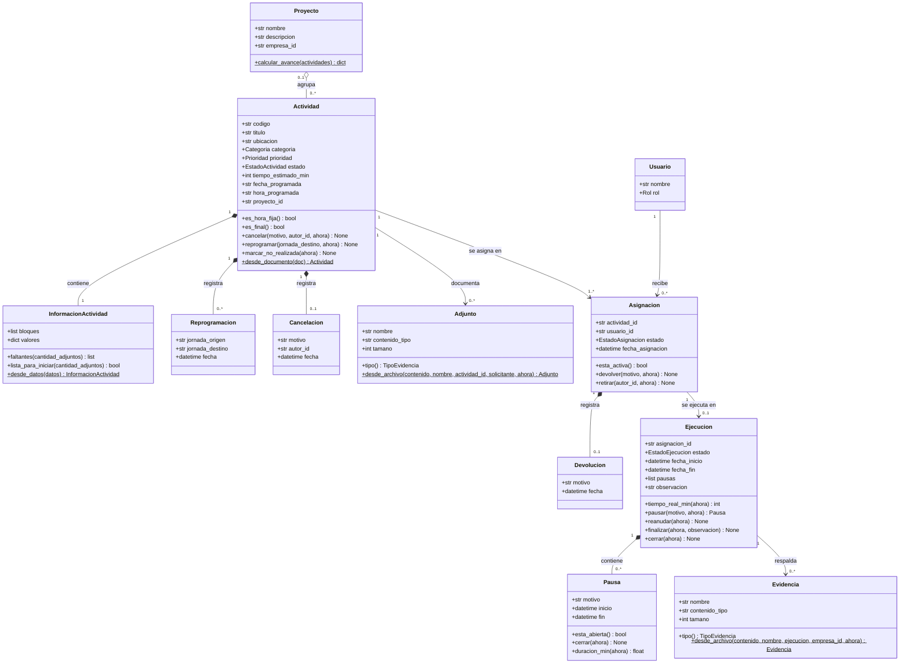

- **La ejecución pertenece a la asignación.** Una actividad se asigna a uno o varios operarios, y cada `Asignacion` tiene su propia `Ejecucion` con su tiempo, sus pausas y su observación. Por eso la pausa de un operario no pausa a los demás.
- **Composición.** Las `Pausa` se guardan dentro del documento de su `Ejecucion`, y la `Reprogramacion`, la `Cancelacion` y la `InformacionActividad` dentro de su `Actividad`: no existen sin su dueño. En cambio, la `Evidencia` y el `Adjunto` son archivos y se guardan en su propia colección; por eso son asociaciones.
- **Agregación.** Un `Proyecto` agrupa actividades, pero una actividad puede existir sin proyecto (actividad independiente).
- **Las reglas viven en los métodos.** `Ejecucion.pausar()` lanza un error si la ejecución no está en curso; `Actividad.cancelar()` no deja cancelar lo que ya terminó; `Asignacion.devolver()` exige un motivo. Cada método recibe la hora (`ahora`) como parámetro: la clase no lee el reloj, y por eso se puede probar.

#### 2.6.3 Enumeraciones

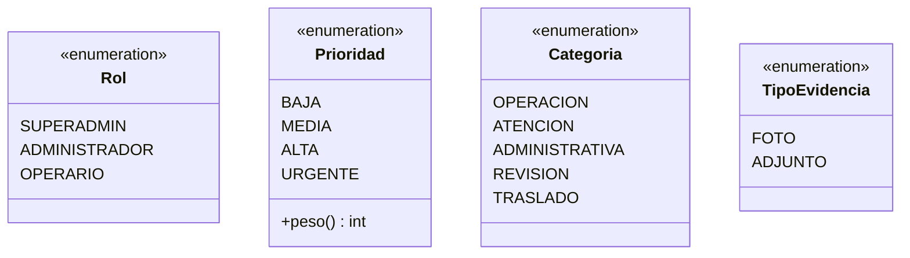

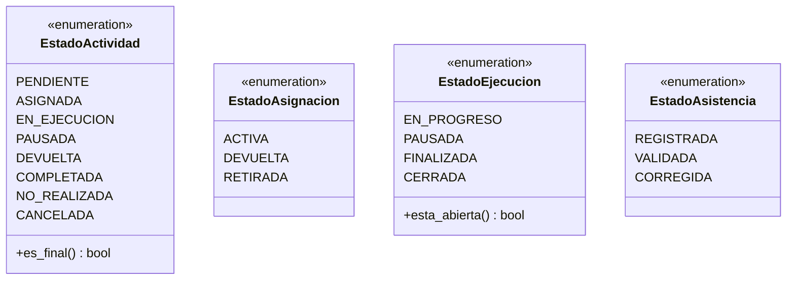

Las enumeraciones también tienen comportamiento. `Prioridad.peso()` da el número con el que se ordenan las actividades, para no comparar textos. `EstadoActividad.es_final()` dice si el estado ya no admite cambios: completada, no realizada o cancelada.

#### 2.6.4 Capas: repositorios y servicios

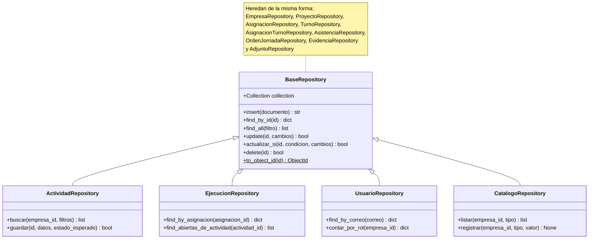

Los servicios se reciben unos a otros por el constructor. Este diagrama muestra quién usa a quién:

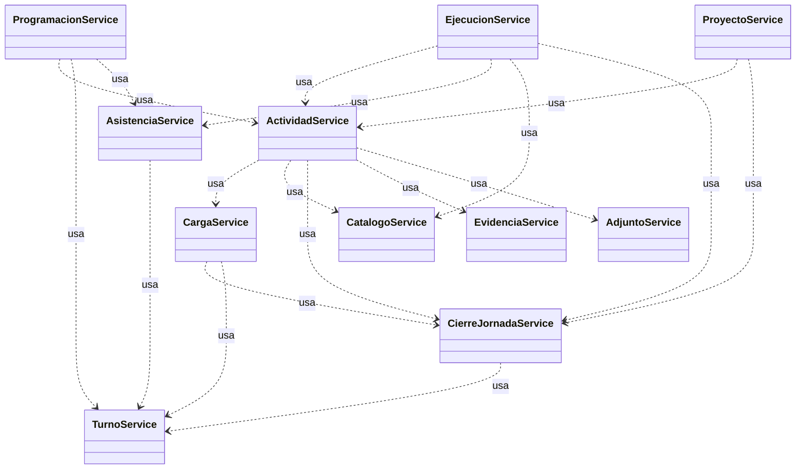

- **Herencia para reutilizar.** Los trece repositorios heredan de `BaseRepository` las operaciones comunes (insertar, buscar por id, actualizar) y solo agregan sus consultas propias. Por ejemplo, `EjecucionRepository` busca las ejecuciones abiertas de un operario.
- **Patrón Repository.** Los repositorios son el único lugar del código que habla con MongoDB. Si mañana cambiara el motor, solo cambiarían ellos.
- **Inyección de dependencias por el constructor.** Ningún servicio crea los objetos que usa: los recibe al construirse. Todos se arman en un solo lugar, `construir_servicios` en `app/services/composicion.py`. Eso permite probarlos con una base en memoria.
- **Colaboración entre servicios.** Cada servicio tiene una responsabilidad y le pide a otro lo que no le corresponde. Por ejemplo, `EjecucionService` le pregunta a `AsistenciaService` si el operario marcó la entrada antes de dejarlo iniciar una actividad.

Además de los servicios que dependen de otros, cada uno usa los repositorios de los datos que maneja:

| Servicio | Repositorios que usa |
|---|---|
| `ActividadService` | Actividades, asignaciones, usuarios, ejecuciones, empresas y proyectos |
| `EjecucionService` | Ejecuciones, actividades y asignaciones |
| `ProgramacionService` | Orden del día, empresas y usuarios |
| `AsistenciaService` | Asistencias, usuarios, empresas y ejecuciones |
| `TurnoService` | Turnos, asignaciones de turno, usuarios y empresas |
| `CierreJornadaService` | Actividades, asignaciones, ejecuciones y empresas |
| `CargaService` | Actividades, asignaciones y usuarios |
| `EvidenciaService` y `AdjuntoService` | Evidencias o adjuntos, ejecuciones, actividades y asignaciones |
| `ProyectoService` | Proyectos y actividades |
| `CatalogoService` | Catálogos |
| `UsuarioService`, `EmpresaService` y `AuthService` | Usuarios y empresas (y, para desactivar, turnos y asignaciones) |


## 3. Interfaz del sistema

El diseño pasó por tres momentos, y de cada uno hay evidencia en el repositorio.

| Momento | Qué es | Dónde está |
|---|---|---|
| Bosquejos y maquetas | Composición de cada pantalla antes de programarla | `docs/disenos/` |
| Exploración con una herramienta de diseño | Propuesta generada en Google Stitch y su revisión crítica | `docs/disenos/stitch_calma_operativa/` |
| Prototipo funcional | La interfaz real, conectada a la API y a la base | `app/static/` |

**Maquetas**

| Archivo | Pantalla |
|---|---|
| `2_admin_equipo_tablero.png` | Administrador: tablero del turno, una fila por persona |
| `3_admin_proyecto.png` | Administrador: detalle de un proyecto |
| `4_operario_fila_del_tablero.png` | Operario: su día, actividad urgente, detalle y devolver |
| `5_operario_ordenar_dia.png` | Operario: hora fija, horario flexible y ordenar el día |
| `6_operario_hora_fija_parte.png` | Operario: actividad interrumpida por una de hora fija |

**Decisiones de diseño**

- **Metáfora central:** la planilla del turno de un equipo de trabajo: quién hace qué y a qué hora. El Administrador ve la planilla completa y el Operario ve su propia fila, en vertical.
- **Una página que recibe al Operario:** al iniciar sesión llega a su Inicio, con su turno, su jornada y la marca de entrada; su día está en una pantalla aparte.
- **Sistema visual:** colores, tipografía y espacios definidos como variables en un solo archivo (`app/static/css/estilos.css`), para que todas las pantallas se vean iguales.
- **Estados:** siempre con color, ícono y texto, para no depender solo del color.

**Del bosquejo al prototipo funcional**

<div class="figuras">
<figure>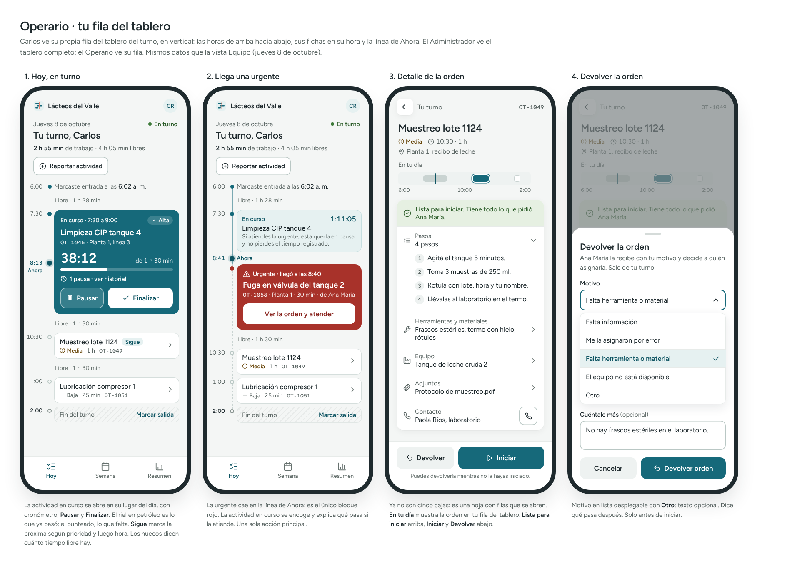<figcaption>Figura 1. Maqueta de la pantalla Hoy del Operario.</figcaption></figure>
<figure>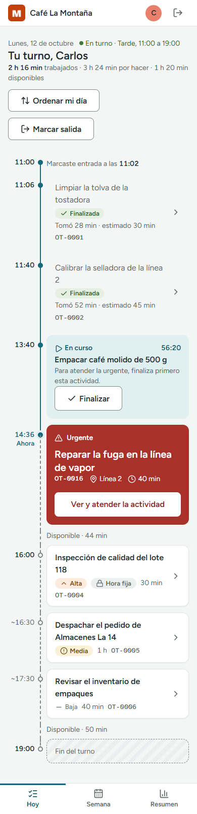<figcaption>Figura 2. La misma pantalla, ya construida y con datos reales.</figcaption></figure>
</div>

<div class="figuras">
<figure>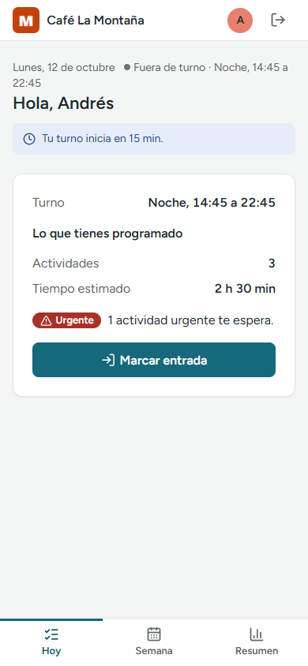<figcaption>Figura 3. Operario: inicio de la jornada.</figcaption></figure>
<figure>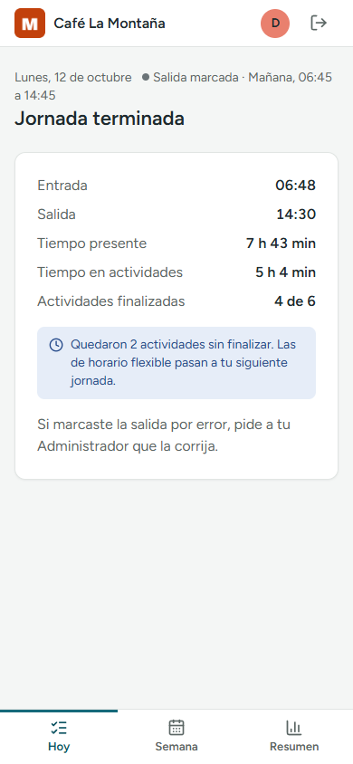<figcaption>Figura 4. Operario: cierre de la jornada.</figcaption></figure>
<figure>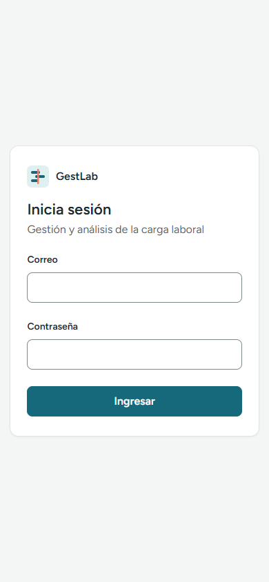<figcaption>Figura 5. Inicio de sesión.</figcaption></figure>
</div>

<figure>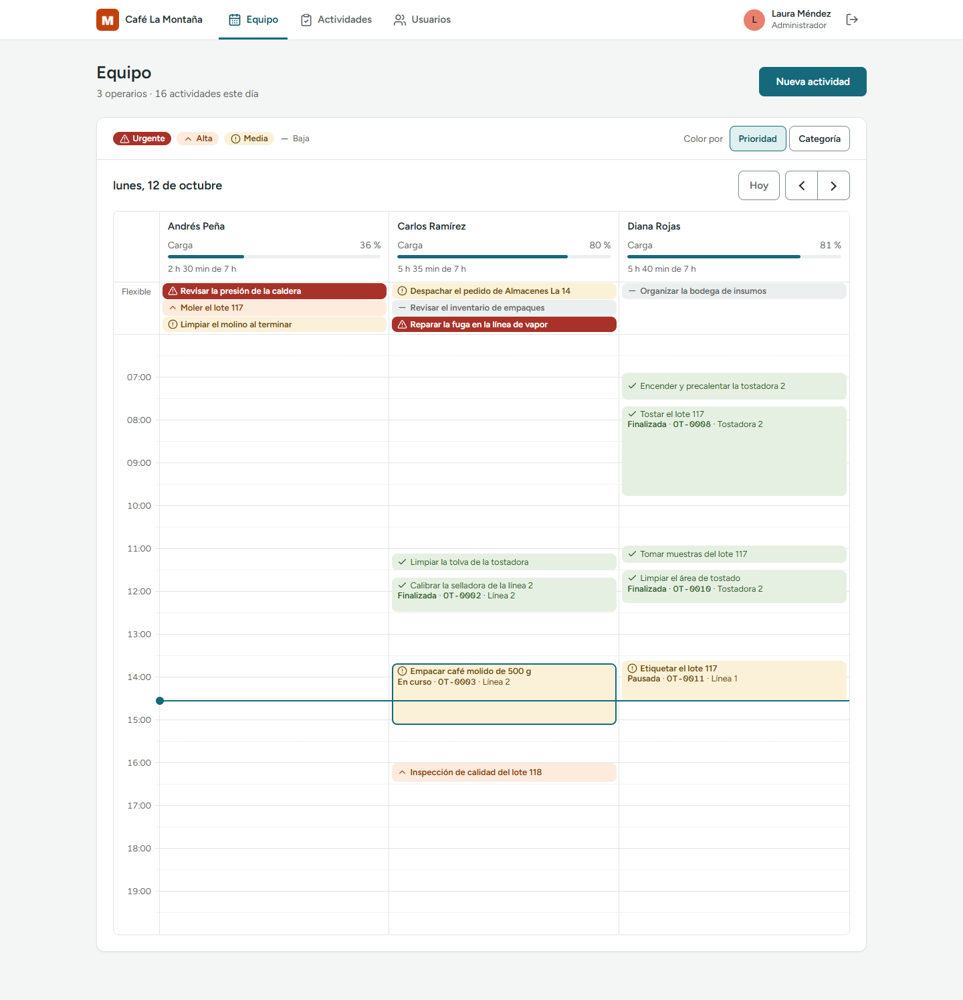<figcaption>Figura 6. Administrador: horario del equipo, con la carga de cada operario.</figcaption></figure>

<figure>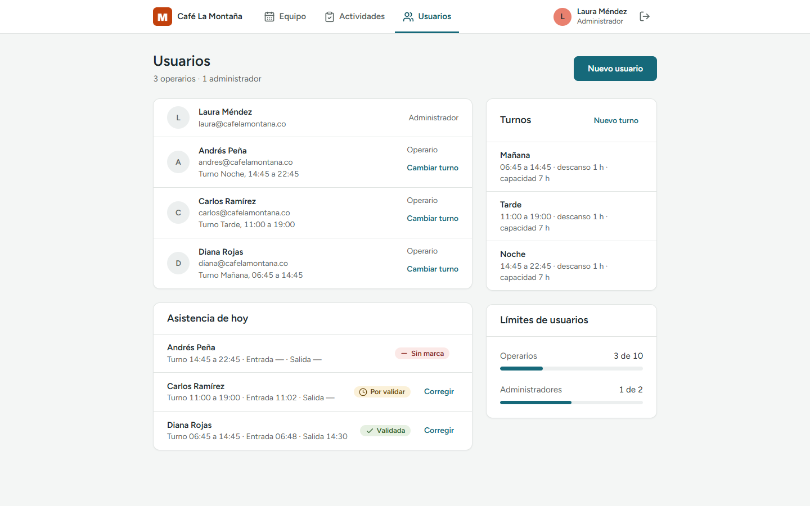<figcaption>Figura 7. Administrador: usuarios, turnos y asistencia del día.</figcaption></figure>

Las capturas se tomaron de la aplicación corriendo, con datos de demostración. El diseño de la interfaz se documenta en detalle en el trabajo de Diseño de Interfaces.

---

## 4. Organización del equipo

| Integrante | Rol | Responsabilidades | Actividades a cargo |
|---|---|---|---|
| Pedro David González Lesmes | Desarrollo | Construir el sistema: clases del dominio, base de datos, servicios, API e interfaz web. Mantener la separación en capas y que el código pase las pruebas automáticas | Modelo de clases y su implementación; modelo físico en MongoDB; conexión con la base; pantallas de los tres roles; script de migración de datos |
| Sebastián Vargas | Documentación, pruebas y seguimiento | Mantener los documentos al día con lo construido, probar que el sistema funcione como dice el alcance y llevar el control del avance frente al plan | Documento de alcance y bitácora; documentos de avance de cada momento; pruebas funcionales con los usuarios de prueba y reporte de errores; seguimiento de lo hecho y lo pendiente en `docs/avance.md` |

**Forma de trabajo**

- Control de versiones con Git y GitHub. Cada funcionalidad se hace en una rama propia y se integra por Pull Request.
- Antes de integrar, el código debe pasar las pruebas automáticas y el análisis de SonarQube.
- Las reglas del sistema se escriben primero en el documento de alcance; el código sigue al alcance.

---

## 5. Socialización del avance

### 5.1 Qué se ha desarrollado

| Criterio del producto mínimo | Estado |
|---|---|
| Empresas y usuarios con tres roles | Terminado |
| Asignación y prioridad | Terminado |
| Actividades y proyectos | Parcial: las actividades funcionan completas, con su información por bloques y archivos adjuntos; los proyectos ya están en la API y falta su pantalla |
| Ejecución (iniciar, pausar, reanudar, finalizar) | Terminado: las cuatro acciones en pantalla, con motivo de pausa, atención de urgentes y evidencia al finalizar |
| Registro de tiempo | Parcial: el servidor lo calcula y la programación del día usa los tiempos reales; falta compararlo en pantalla con el estimado |
| Análisis de carga laboral | Parcial: carga por jornada, alerta al superar el 100 % y tiempo que pasa del turno |
| Turnos y asistencia | Parcial: el operario marca entrada y salida desde su Inicio, con alerta de llegada tarde, y el Administrador valida o corrige; falta el aviso de posible ausencia al Administrador |
| Indicadores de cumplimiento | Pendiente |

### 5.2 Qué falta por completar

1. Pantalla del Operario: aviso de hora fija, devolver una actividad, Semana con cada actividad en su hora, un Resumen con lo programado frente a lo real, y una página de perfil para cambiar la contraseña.
2. Pantallas del Administrador: proyectos; retirar los requerimientos de la base.
3. Indicadores de cumplimiento.
4. Aviso de posible ausencia al Administrador y reasignación por ausencia.
5. Definir la identidad visual final de la interfaz (se trabaja en Diseño de Interfaces).

### 5.3 Dificultades encontradas

- **De quién es la ejecución.** Al permitir varios operarios en una actividad, no estaba claro si el tiempo era de la actividad o de cada persona. Se decidió que la ejecución pertenece a la asignación, y eso cambió el modelo de datos.
- **Peticiones simultáneas.** Validar en el código "este operario no tiene nada en curso" no basta si llegan dos peticiones a la vez. Se resolvió con índices únicos en la base.
- **Cambiar el modelo con datos ya guardados.** Pasar de requerimientos a proyectos exigió un script de migración (`herramientas/migrar_etapa4.py`) para no perder la información existente.
- **Turnos de noche.** Un turno que empieza un día y termina al siguiente obligó a definir la jornada como el día en que inicia el turno.
- **La hora de los eventos.** Para que los tiempos sean confiables, la hora la pone siempre el servidor, nunca el navegador.
- **Borrar o conservar.** Borrar una actividad, un usuario o una empresa dejaba registros sin dueño. Se decidió que nada se borra: las actividades se cancelan y los usuarios y las empresas se desactivan.
- **Categorías que sirvan para cualquier empresa.** Las primeras categorías (producción, mantenimiento, limpieza) eran de una planta y no de cualquier área de trabajo. Se cambiaron por categorías generales y se migraron los datos con un script (`herramientas/migrar_categorias.py`).
- **Archivos que suben los usuarios.** Un archivo puede decir que es una foto y no serlo. Por eso el tipo se reconoce por sus primeros bytes, se limita su tamaño y la cantidad, y las fotos se reducen en el celular antes de subirlas.
